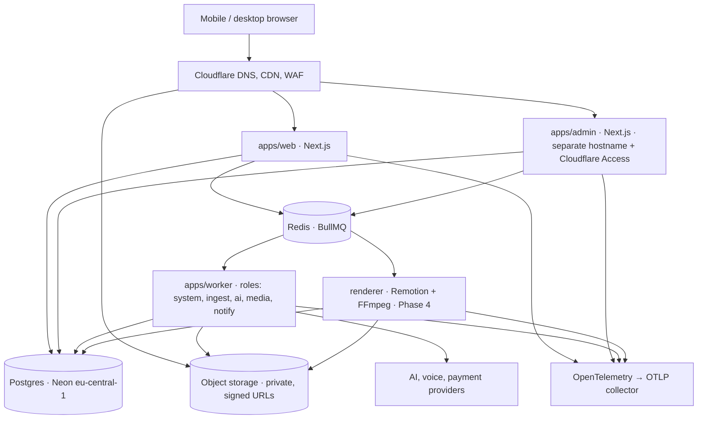

# Architecture

DeX is a TypeScript modular monolith: two Next.js applications (customer, staff), a background worker process and (from Phase 4) a renderer process, all sharing a single Postgres database and a set of workspace packages with enforced dependency direction. Expensive and long-running work never runs inside an HTTP request.

## Process topology



Phase 1 ships `web`, `admin` and `worker` (system role). The renderer and the other worker roles are declared in the queue contracts and refuse to start until implemented (`apps/worker/src/main.ts` throws on an unimplemented role rather than running a no-op).

## Package dependency direction

```
apps/* ──► domain ──► db ──► env ──► config
   │          │        ▲
   │          └──► auth, queue, storage, flags, email, observability
   └──► ui (Phase 1 design track)
```

Rules enforced by `dependency-cruiser` in CI:

- apps never import other apps; packages never import apps
- `db` depends only on `env`/`config` (it is a leaf: schema, migrations, client)
- `ui` is presentational and cannot import server packages
- no circular dependencies

The staff permission catalogue lives in `db` (static data) so both the seed and `domain.authorize()` share one definition without a cycle.

## Request lifecycle (customer app)

1. Edge proxy (`apps/web/proxy.ts`) performs a cookie-presence check for `/dashboard` and `/onboarding` and redirects obviously signed-out users. It is a hint, not authorization.
2. The `(app)` layout resolves the session server-side (`getPrincipal()`), loads org memberships from the DB, and redirects when absent.
3. Pages call `authorizeOrg(principal, orgId, minRole)` before any tenant data access.
4. Tenant data access always runs inside `withTenant(db, { orgId, actorId }, tx => …)`, which sets `app.org_id` for the transaction so Row-Level Security applies (see DATABASE.md).
5. Mutations run as Server Actions; privileged ones write an `audit_event` row in the same transaction.

## Request lifecycle (staff app)

1. Optional IP allowlist is checked before the session is read (`STAFF_IP_ALLOWLIST`).
2. `getStaffPrincipal()` resolves permissions from `staff.user_role → staff.role_permission` on every request (no caching) so revocation is immediate.
3. `requireStaff(permission)` throws `DomainError` on failure and records a `denied` audit event for authenticated principals.
4. Permissions flagged `stepUp` in the catalogue require `staff.session.step_up_verified_at` within 5 minutes; otherwise the action redirects to `/step-up`, which re-verifies the password (and TOTP when enrolled) and stamps the session.
5. Customer content is never readable by staff by default; `staff.content_access_grant` (break-glass, time-boxed, justified, audited) is the only path (Phase 7 UI).

## Background jobs

- Contracts: every job payload is a Zod schema carrying `{ orgId, actorId, requestId, idempotencyKey }`.
- Producers validate and enqueue with `jobId = idempotencyKey`, so duplicate submissions coalesce.
- Workers validate on receipt; unparsable payloads fail with `UnrecoverableError` (no retries).
- Handlers receive an `AbortSignal` that fires on worker shutdown; long steps must observe it.
- Progress is published via `job.updateProgress({ percent, stage, message })`; Phase 2 adds the SSE relay.
- Default retry policy: 3 attempts, exponential backoff from 2s; completed jobs kept 24h, failed 7 days.

Queue names (`system`, `ingest`, `ai`, `media`, `render`, `notify`) are stable identifiers and must not be renamed.

## Configuration

All processes load configuration through `packages/env` (Zod schemas composed per process). Missing or invalid keys fail at boot with a list of key names, never values. Secret keys are enumerated in `SECRET_KEYS` and redacted from logs.

## Phase roadmap

| Phase | Scope                                                                                                           | Status               |
| ----- | --------------------------------------------------------------------------------------------------------------- | -------------------- |
| 0     | Discovery and architecture package                                                                              | done                 |
| 1     | Foundation: monorepo, auth realms, RLS, RBAC, audit, flags, queue, storage, CI                                  | **done (this repo)** |
| 2     | Product and brand intelligence: SSRF-safe capture, extractors, GitHub App, evidence model, brand profile review | next                 |
| 3     | Marketing intelligence: AI provider registry/routing/metering, concepts, storyboards, originality fingerprints  |                      |
| 4     | Creative production: scene archetypes, renderer, audio mixing, TTS, captions, catalogue                         |                      |
| 5     | Integrated editor: timeline, conversational edits, versions, autosave, mobile editor                            |                      |
| 6     | Deliverables and billing: thumbnails, copy, subtitles, Paddle + Paystack, usage ledger                          |                      |
| 7     | Backoffice completion: user/org management, content access grants, moderation, tickets                          |                      |
| 8     | Hardening: load, DR drills, pen-test, SOC 2 readiness                                                           |                      |

The Phase 0 package (technology choices, platform evaluation, payments, AI, originality, rendering, cost model) is summarised in `docs/DECISIONS/` and `docs/DEPENDENCY_BASELINE.md`.
