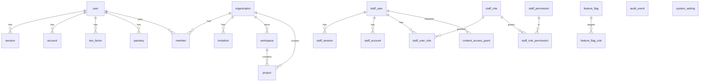

# Database

Postgres (Neon in shared environments, Docker locally). Schema is defined in Drizzle (`packages/db/src/schema`), migrations are generated SQL under `packages/db/drizzle` and applied with `drizzle-kit migrate` semantics through `packages/db/src/migrate.ts`. `drizzle-kit push` is never used against shared databases.

## Roles

| Role                | Used by                      | Notes                                                             |
| ------------------- | ---------------------------- | ----------------------------------------------------------------- |
| `dex_admin` (owner) | migrations, dev seed, ops    | bypasses RLS as the table owner; `DATABASE_ADMIN_URL`             |
| `dex_app`           | web, admin, worker, renderer | `NOBYPASSRLS`; `DATABASE_URL`; cannot update/delete `audit_event` |

The app role must exist before the first migration: `docker/postgres/init/01-roles.sql` locally; the Neon console/API in staging and production (`CREATE ROLE dex_app LOGIN NOBYPASSRLS` + password managed there).

## Tenancy and Row-Level Security

- Tenant boundary: `organization` (Better Auth organization plugin). Every tenant-scoped table carries `org_id text NOT NULL REFERENCES organization(id)`.
- Policies: `FOR ALL TO dex_app USING (org_id = current_setting('app.org_id', true)) WITH CHECK (…)`. With no setting, `current_setting(..., true)` is NULL and every row is denied.
- The application sets the tenant per transaction: `withTenant(db, { orgId, actorId }, fn)` runs `select set_config('app.org_id', $1, true)` inside the transaction. Transaction-local settings are safe behind PgBouncer / Neon transaction pooling.
- RLS is defense in depth. Application code still scopes queries by `org_id` and checks membership with `authorizeOrg()` first.
- Composite indexes lead with `org_id`.

Verified by `packages/db/src/tenancy.integration.test.ts`: cross-tenant read returns nothing, cross-tenant insert is rejected by `WITH CHECK`, queries outside `withTenant` return zero rows, the owner role sees everything.

## Staff aggregates

The staff backoffice needs platform-wide counts without row access. `platform_counts()` is a `SECURITY DEFINER` SQL function owned by `dex_admin` and granted to `dex_app`; it returns counts only. Any future aggregate for staff follows the same pattern rather than loosening RLS.

## Audit log

`audit_event` is append-only:

- `UPDATE/DELETE/TRUNCATE` revoked from `PUBLIC` and `dex_app`
- a statement-level trigger raises `insufficient_privilege` for the owner too
- rows are hash-chained: `hash = sha256(previous_hash || canonical(row))`, written by `recordAudit()` in `packages/domain`

Verified by the integration test for both roles.

## Entities (Phase 1)

Schemas: customer auth and tenancy in `public`; staff realm in `staff` (its own schema so staff identities never share tables with customers).

## Conventions

- Domain primary keys are UUIDs generated by the application (UUIDv7, `newId()`), with `gen_random_uuid()` as the column default.
- Better Auth tables keep its text ids.
- `created_at` / `updated_at` are `timestamptz`; `updated_at` is maintained both by Drizzle's `$onUpdate` and by a trigger for raw SQL writers.
- Enums are Postgres enums (`project_status`, `audit_actor_type`, `audit_result`).
- JSONB columns carry a TypeScript type via `$type<>()`.

## Migration workflow

1. Edit schema files.
2. `pnpm db:generate` → review the SQL diff in the PR.
3. Hand-written SQL (grants, triggers, functions) goes in a `--custom` migration (see `0001_hardening.sql`, `0002_platform_counts.sql`).
4. CI applies all migrations to a fresh Postgres before integration tests; staging applies them to a Neon branch before promotion.
5. Schema changes are expand/contract: additive first, destructive only after code no longer references the column.

## Later phases

Product intelligence (`product_source`, `product_evidence`, `product_claim`, `brand_profile_version`), creative production (`campaign`, `concept`, `production_version` with immutable JSONB specs and JSON Patch diffs, `creative_fingerprint` with pgvector), media/licensing, processing (`workflow_execution`, `render_job`), commercial (`subscription`, `usage_ledger`, `webhook_event` with `(provider, provider_event_id)` unique) and administration tables are added phase by phase, each with `org_id` + RLS where tenant-scoped. `usage_ledger`, `audit_event` and `job_event` move to monthly range partitions past ~10M rows.
