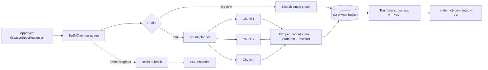
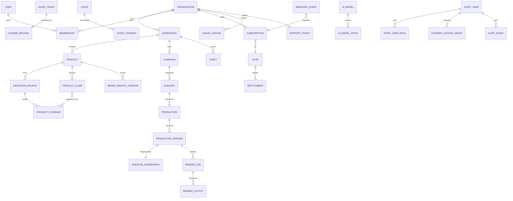
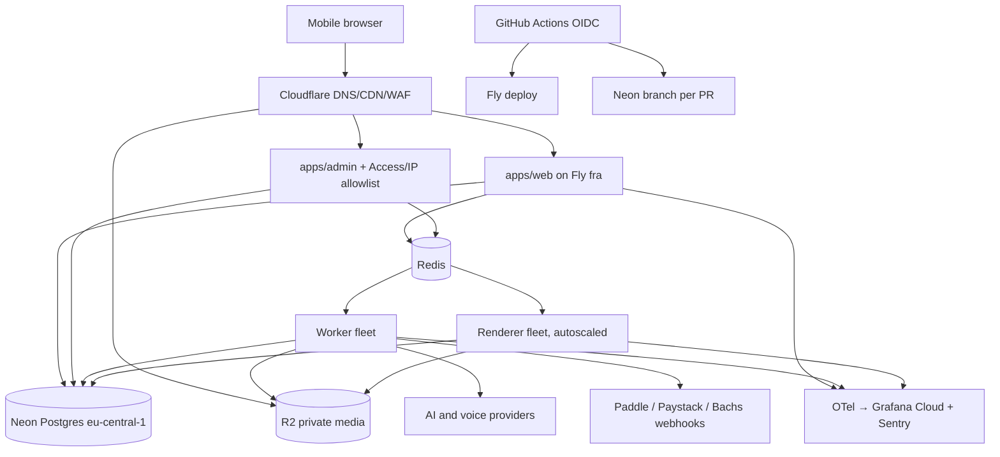
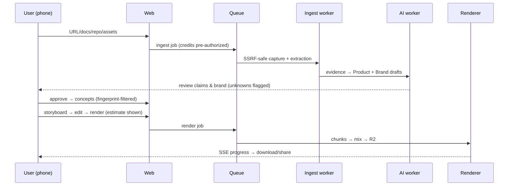

# DeX Phase 0 — Discovery & Architecture Package (verified 4 November 2026)

DeX should be built as a TypeScript modular monolith: Next.js 16.4 on Node.js 26 LTS, Neon Postgres in Frankfurt as the system of record, zero-egress object storage (Cloudflare R2-class) for media, and container-based worker and render fleets (Remotion 4 + FFmpeg) on a machine-level host. Rendering must not run on Neon Functions, Vercel functions or any other serverless runtime. For payments, pair a merchant of record (Paddle) for international card subscriptions and tax with a Nigerian PSP for naira and African local methods (Paystack first, Bachs as a monitored second adapter), all behind one provider-agnostic billing domain.

## TL;DR

- **Platform:** Use Neon for Postgres only, starting on Launch and moving to Scale when SOC 2 or a 30-day restore window is needed. Self-host Better Auth, run BullMQ on a fixed-price Redis, and run Remotion/FFmpeg in Docker on autoscaled machines. Neon Functions have a 15-minute time-to-first-byte limit, a fixed 2048 MiB of memory and 100 concurrent invocations per account, and Neon itself says they are "not a background job runner". That rules them out for 10–60 minute, multi-GB render jobs.
- **Payments:** Bachs (Bachs Technologies Limited, Nigeria) is a payment-technology provider, not a merchant of record. Its terms say "You are the seller of record", it charges 5% + 40¢ on international cards, and its licensed partners are not named. It is unsuitable as DeX's first or only provider for global sales. Launch with Paddle (merchant of record; Nigeria is not on its unsupported-seller list; it collects Nigeria's 7.5% VAT) plus Paystack, whose official pricing page states "1.5% + NGN 100 For Local Transactions… Local transactions fees are capped at ₦2000." Keep Bachs behind the adapter for pan-African mobile money once due diligence clears.
- **AI and creative engine:** Use the Vercel AI SDK provider packages as transport adapters under DeX's own orchestration layer. Keep a DB-stored model registry and versioned cost tables, and call providers directly. Base originality on a deterministic, Zod-validated CreativeSpecification plus a structural CreativeFingerprint compared only against abstract fingerprints. Never accept "this is unique" because an LLM says so.

---

## Recommendations summary

| Area | Recommendation | Confidence | Reason |
|---|---|---|---|
| Runtime | Node.js 26 LTS "Lithium" (26.13.0, LTS since 28 Oct 2026, supported to end of April 2029)\[1\] | High | Longest runway; Node 24 entered Maintenance 20 Oct 2026\[2\] |
| Web | Next.js 16.4.x App Router, React 19.3 | High | Current stable; Cache Components now recommended\[3\] |
| Monorepo | pnpm workspaces + Turborepo | Medium | Lightweight task graph; Nx heavier than needed |
| Database | Neon Postgres, aws-eu-central-1 (Frankfurt) | High | Branching, PITR, standard Postgres exit path |
| ORM | Drizzle (0.45.x stable; 1.0 when GA)\[4\] | Medium | SQL-first, RLS policies, `pg` Pool + Neon driver |
| Queue | BullMQ on dedicated Redis | Medium-High | Progress, priorities, flows; avoids keeping Neon compute awake |
| Rendering | Remotion 4.0.x self-hosted; FFmpeg 8.1.x LGPL build | High | Deterministic React scenes; license understood |
| Storage/CDN | Cloudflare R2 behind S3 API abstraction | Medium | Video egress dominates storage cost |
| Hosting | Docker on Fly.io Machines (fra) for all process groups | Medium | Co-located with Neon; one image pipeline |
| Auth | Self-hosted Better Auth, separate customer and staff realms | Medium | MFA, passkeys, orgs, full control |
| AI | Vercel AI SDK provider packages + own `packages/ai`; direct calls | High | Covers all five required vendors |
| Payments | Paddle + Paystack; Bachs later | Medium | Tax offloaded globally; mature NGN rails |
| Observability | OpenTelemetry → Grafana Cloud + Sentry | Medium | Vendor-neutral; GenAI conventions |
| Secrets | Infisical or Doppler | Medium | OIDC to CI, per-env sync |

### Could not verify / needs confirmation

The research budget ran out before the items below could be confirmed from primary sources. Re-check each one (`npm view`, vendor pages) on day 1 of Phase 1 before relying on it.

1. Versions and SPDX identifiers for pnpm, Turborepo, TypeScript, Tailwind v4, shadcn/ui, Radix, Base UI, React Aria, React Hook Form, Zod 4, TanStack libraries, Zustand, Better Auth, Playwright, Vitest, ESLint, Biome, OpenTelemetry JS, Serwist, Uppy/tus, dnd-kit, Vaul, Motion.
2. BullMQ major version. The official changelog shows 5.81.4 (27 Aug 2026), but a BullMQ release note references "release BullMQ v6 with pluggable queue backends", and a third-party package upgraded to BullMQ 6.3.1 on 26 Aug 2026.\[5\]\[6\]\[7\] Confirm the npm `latest` tag before pinning.
3. Drizzle: secondary sources name 0.45.4 as the latest stable (8 Oct 2026); Drizzle's site lists v1.0.0-rc.5 (21 Oct 2026).\[4\]\[8\]
4. OpenAI, Gemini (incl. Veo/Imagen) and xAI model IDs, pricing, structured-output support and zero-retention terms. Anthropic pricing *was* verified.
5. ElevenLabs model names, plan pricing, JS SDK version, and music/SFX commercial terms. Only the voice-cloning rules were verified.
6. Neon egress allowance (secondary sources conflict: 500 GB vs 100 GB), the plan that carries SOC 2/HIPAA, and the AI Gateway markup.\[9\]\[10\]
7. Pricing for Cloudflare R2, Fly.io, Railway, Hetzner, Upstash, Grafana Cloud, Sentry, Resend and Postmark.
8. Bachs: the fees page and payment-method-support page could not be fetched. Withdrawal fees, the licensed partner(s), any CBN licence, refund/dispute timelines and a Go SDK are all unverified. Its own docs are inconsistent on payout rails.
9. Paddle's payout currencies (third-party sources only), and whether Paddle approves an AI video SaaS. The 5% + 50¢ fee is now confirmed on Paddle's own page.
10. Lagos round-trip latency to Frankfurt, Cape Town and Johannesburg. This must be measured.
11. Whether Remotion's bundled FFmpeg includes GPL components (needs legal review).
12. Music/SFX catalogue licenses: Epidemic, Artlist, Soundstripe, Uppbeat, Pixabay, Freesound, Mubert, Beatoven, Soundraw.

---

## A. Technology stack baseline

| Component | Version (4 Nov 2026) | License | Rationale |
|---|---|---|---|
| Node.js | 26.13.0 LTS (LTS 28 Oct 2026; to end of April 2029)\[1\] | MIT | Node 24 is in Maintenance (EOL 30 Apr 2028). From v27 the project ships one major per year and every release becomes LTS. Linux binaries link `libatomic` since Node 25, so include it in base images\[1\]\[11\]\[12\] |
| Next.js | 16.4 (6 Oct 2026); 16.4.4 patch reported 2 Nov 2026 (secondary)\[3\]\[13\] | MIT | Cache Components are the recommended model and the `create-next-app` default. Monthly security releases; several critical RCE fixes shipped in 16.3.x, so patch promptly\[14\]\[15\] |
| React | 19.3 (stable View Transitions, Fragment Refs)\[3\] | MIT | Required by Next 16.4 |
| React Compiler | Experimental Rust compiler in Next 16.3\[16\] | MIT | Do not enable until Phase 8 |
| Turbopack | Default; persistent build cache since 16.3\[16\] | MIT | Defaults |
| pnpm + Turborepo | Unverified | MIT | Strict deps, workspace caching; Bun deferred because Remotion/Playwright toolchains are Node-tested |
| Tailwind CSS v4 | Unverified | MIT | CSS-first `@theme`, OKLCH |
| Components | shadcn/ui pattern on React Aria or Base UI primitives | Apache-2.0 / MIT | Strongest accessible drag/slider/listbox semantics for the editor; Radix only if its maintenance is confirmed |
| Forms | React Hook Form + Zod 4 | MIT | One Zod schema set for API, AI output and spec |
| State | TanStack Query (server); Zustand (editor store only) | MIT | Job polling fallback; undo/redo outside React tree |
| ORM | Drizzle ORM 0.45.x / 1.0.0-rc.5\[4\] | Apache-2.0 | `pgTable.withRLS` in v1, Drizzle Kit generate/migrate, validators in-repo;\[17\]\[18\] Prisma 7/8 viable but heavier for RLS session variables |
| Queue | BullMQ 5.81.x (confirm v6)\[19\] | MIT | See ADR-006 |
| AI SDK | `ai` 7.x (`ai@7.0.155`; 6.x still patched)\[20\] | Apache-2.0 | Provider packages for all required vendors |
| Rendering | Remotion 4.0.540 | Remotion License (source-available) | See G\[21\] |
| FFmpeg | 8.1.3 "Hoare" (21 Sep 2026); 9.0.2 "Lei" also stable | LGPL-2.1-or-later (GPL if GPL parts enabled) | Start on 8.1.x, trial 9.0 in CI\[22\]\[23\] |
| Testing | Vitest, Playwright, Testing Library, BrowserStack real iOS | MIT / Apache-2.0 | iOS media/download behaviour needs real devices |
| Lint | ESLint flat config + typescript-eslint + Prettier (or Biome) | MIT | Choose on verification day |
| Telemetry | OpenTelemetry JS → OTLP | Apache-2.0 | Vendor-neutral |
| Flags | OpenFeature + Postgres provider | Apache-2.0 | ADR-020 |
| Local dev | Docker Compose: Postgres + pgvector, Redis, MinIO, Mailpit, ClamAV, renderer | — | Neon branches for shared envs |

---

## B. Backend platform evaluation

### B1. Neon

**Neon Functions (official runtime-limits page, updated 16 Sep 2026):**
- Node.js 24 runtime, microVM per isolate.\[24\]
- "2048 MiB (fixed, not configurable)" of memory.\[24\]
- "Time to first byte: 15 minutes"; 15-minute stream heartbeat.\[24\]
- `waitUntil` is capped at 15 minutes and is "not a background job runner. Use a dedicated system for work that needs its own lifecycle or cancellation."\[24\]
- The platform "can also evict and restart it for operational reasons", with a 5-second SIGINT grace period.\[24\]
- Default account limit of "100 concurrent invocations".\[24\]

**Conclusion:** rendering, media processing, headless Chromium capture and long AI workflows must not run on Neon Functions. A Remotion render needs Chromium + FFmpeg, 4–16 GB RAM, scratch disk and 10–60 minute runtimes. Arbitrary eviction, the 2 GiB cap and the 100-invocation cap each disqualify it on their own.

**Pricing (Neon plans docs):**

| Item | Free | Launch | Scale |
|---|---|---|---|
| Compute | 100 CU-hours/project | $0.106/CU-hour | $0.222/CU-hour |
| Storage | 1 GB/project, 20 GB account | $0.35/GB-month | $0.35/GB-month |
| Instant restore | n/a | $0.20/GB-month | $0.20/GB-month |
| History window | 6 hours (≤1 GB changes) | up to 7 days | up to 30 days |
| Object Storage | 5 GB/project | $0.023/GB-month | $0.023/GB-month\[25\] |

What this means for DeX:

- **Compliance and minimums (secondary sources):** Scale includes SOC 2 Type 2 and HIPAA eligibility, and paid plans have had no monthly minimum since December 2025. Scale-to-zero defaults to 5 minutes. Scale doubles the compute rate,\[26\] so stay on Launch until compliance needs force the move.\[9\]\[10\]\[27\]
- **Avoid polling queues on Neon:** a worker fleet polling Postgres keeps compute awake permanently. At 1 CU × 730 h that is ≈$77/month on Launch and ≈$162/month on Scale,\[26\] which is a concrete reason not to use a Postgres-polling queue.\[27\]
- **Lock-in:** the core is standard Postgres. The Neon-specific pieces are branching, the serverless driver, `neon.ts`, the `neon_auth` schema, Functions, Object Storage branching and the AI Gateway. DeX uses only Postgres and branching, so exit is a dump/restore or logical replication.
- **Region:** Object Storage, Functions and AI Gateway exist only in us-east-2, us-east-1, eu-central-1 and ap-southeast-1, with no African region. Frankfurt is the best fit. Lagos latency to Frankfurt, AWS af-south-1 and Fly jnb must be measured in a Phase 0 spike.
- **Neon Managed Better Auth vs self-hosted:** DeX needs two isolated realms, staff-only MFA enforcement, IP allowlists, step-up auth, custom workspace semantics and audit hooks. Self-hosting the same library keeps all of this in DeX's own migrations. **Decision: self-host.**
- **Neon AI Gateway:** frontier models need an access request and a paid plan, and the gateway is tied to Neon's regions. Not primary.

### B2. Alternatives (1–5, 5 = best fit)

| Platform | Postgres | Long-running containers | Media egress | Africa proximity | Previews | Verdict |
|---|---|---|---|---|---|---|
| **Neon + R2 + Fly Machines** | 5 | 5 | 5 | 3 | 5 | **Recommended** |
| Supabase | 4 | 1 (Edge Functions unsuitable) | 3 | 3 | 3 | Good DB, wrong compute |
| AWS (RDS/Aurora Sv2, S3, Fargate, af-south-1) | 4 | 5 | 2 | 4 | 2 | Strong at scale; heavy ops |
| GCP (Cloud SQL, Cloud Run jobs, Johannesburg) | 4 | 4 | 2 | 4 | 2 | Viable render fleet |
| Azure (South Africa North) | 4 | 4 | 2 | 4 | 2 | No advantage |
| Cloudflare (Workers, Containers, R2, Lagos PoP) | via Hyperdrive | 3 | 5 | 5 | 3 | Use for R2/CDN only |
| Railway / Render | 3 | 4 | 2–3 | 2 | 4 | Simple fallbacks |
| Fly.io | 2 | 5 | 3 | 4 (jnb) | 3 | Recommended compute |
| Hetzner | self-run | 5 | 3 | 2 | 1 | Cheapest render fleet at scale |

### B3. Next.js hosting

- **Vercel:** first-class Next.js support. Video bytes must never flow through its functions, and DeX would be running a second platform. Acceptable for `apps/web` only.
- **Netlify / Cloudflare OpenNext:** Next.js 16.2 added official deployment Adapters,\[28\] but parity with Cache Components needs testing.
- **Recommended: self-hosted Docker on Fly.io (fra).** Same pipeline as the workers, single-digit-millisecond round trips to Neon, SSE without platform timeouts, and per-PR preview apps.

### B4. Monthly cost estimates (indicative)

**Assumptions:**
- 2.5 final renders per campaign, each 45 s at 1080p30 (~45 MB).
- ~6 machine-minutes per final render on 4 vCPU/8 GB.
- ~300K input / 40K output LLM tokens per campaign, mostly on Sonnet-class models with caching.
- One ~700-character voiceover per campaign.

| Item | Pre-launch | 1,000 users / 2,000 renders | 20,000 users / 50,000 renders |
|---|---|---|---|
| Neon | $0–20 | $40–90 | $250–700 (Scale) |
| Redis | $0–10 | $15–40 | $60–150 |
| Render/worker compute | $10–30 | $40–120 | $600–2,000 |
| Web/admin containers | $10–30 | $40–100 | $200–500 |
| R2 storage / egress | $0–5 | $5–40 | $75–250 |
| LLM tokens (Sonnet 5.5 $2/$10, Haiku 5.5 $0.10/$0.50 per MTok)\[29\] | $20–100 | $600–1,500 | $12,000–30,000\[30\] |
| TTS/STT (unverified pricing) | $0–30 | $100–400 | $2,000–8,000 |
| Remotion license (4+ people) | $0 | $100 | ~$500+ |
| Observability, email, secrets, scanning | $0–50 | $100–250 | $500–1,500 |
| **Total** | **$40–300** | **$1,100–2,700** | **$16,000–44,000** |

**Interpretation:** AI inference and voice account for 70–80% of variable cost; rendering is comparatively cheap. The main levers are:
- model routing (Haiku-class models for extraction),
- prompt caching (Opus 5.5 cache hits cost $0.20/MTok vs $4 input),\[30\]\[31\]
- the 50%-off Batch API,
- caching ingestion results,
- credits charged for regenerations,
- moving the render fleet to Hetzner.

Budget for one tokenizer effect: Claude 4.7-and-later models produce "approximately 30% more tokens for the same text".\[30\]

---

## C. Payment provider evaluation

### C1. Bachs, verified

| Topic | Finding |
|---|---|
| Entity | Bachs Technologies Limited, "incorporated in the Federal Republic of Nigeria (RC No. 9494536)"; Merchant Terms effective 1 Aug 2026\[32\] |
| Role | "You are the seller of record for every Transaction." Bachs is "a technology provider and does not itself perform those regulated activities"; these are performed by "licensed financial institutions and payment service providers", which "may change at any time"\[32\] |
| MoR | **No.** DeX keeps VAT/sales-tax obligations ("You remain responsible for your own tax and regulatory obligations")\[33\] |
| Licensing | No CBN licence or partner name found; due-diligence item |
| Fees (bachs.io/pricing) | NGN bank transfer 1.5% capped at ₦2,000; virtual accounts 1% capped at ₦300; local cards 2%; international cards 5% + 40¢; mobile money 2% (GH/KE), 3% (other markets); crypto 1.5%\[34\] |
| Fee terms | 14 days' notice of fee changes; fees retained on refunds and chargebacks; a US$15 chargeback fee may be passed through; FX "includes a margin"\[32\] |
| Collection | USD cards from "120+ countries", Apple Pay/Google Pay, settled to USD; NGN bank transfer; mobile money in GHS, KES, MWK, RWF, TZS, UGX, XAF, XOF, ZMW; crypto\[35\]\[36\] |
| Payouts | Docs list NGN plus GHS, KES, TZS, UGX, GBP, USD, CAD, EUR bank payouts, but the Connect walkthrough says payable rails today are NGN bank and USDT_TRC20/BEP20, with mobile money "rejected on currency". **Inconsistent; verify in sandbox**\[36\]\[37\] |
| Subscriptions | Via checkout of a recurring product only;\[36\] USD cards only; `BASE_CURRENCY_NOT_HELD_BY_ORG` |
| SDK | `@bachs/sdk` 1.0.0 (TypeScript, Node 22+, no runtime deps); Python SDK not yet run against live sandbox per its README;\[38\]\[39\] Go not found |
| Status | status.bachs.io shows 99.695–99.821% uptime (period not shown)\[40\] |

**Assessment:** the API design is good: decimal-string money, versioned HMAC webhooks, a CLI and a starter app. The single checkout spanning NGN transfer, nine mobile-money currencies and crypto is unusually broad.\[36\] Four things disqualify it as the sole first provider:
- it is not a merchant of record,
- international cards cost 5% + 40¢,
- subscriptions are USD-card-only,
- its licensed partners are undisclosed.

Adopt Bachs as a second adapter after three conditions are met: written partner disclosure, sandbox-verified payouts, refunds and disputes, and several months of status history.

### C2. Comparison

| Provider | Nigerian company onboarding | MoR/tax | NGN local | Intl cards | Recurring | Notes |
|---|---|---|---|---|---|---|
| **Paddle** | Yes (not on unsupported-supplier list)\[41\] | **MoR**; Nigeria VAT 7.5% B2B & B2C,\[42\] EU/UK VAT, US sales tax | No | Yes | Trials, proration, dunning, portal | Official pricing: "Pay-as-you-go 5% + 50¢ per Checkout transaction", with custom pricing for high volume; wire ($15 fee) or Payoneer payouts; no NGN payout; product approval required |
| **Paystack** | Yes (NG, GH, KE, ZA, CI)\[43\] | PSP | Cards, transfer, USSD, virtual accounts | 3.9% + NGN 100 (Mastercard, Visa, Verve) or 4.5% (American Express) on NGN pricing; 3.9% with no flat fee on USD pricing | Card-token subscriptions | Local 1.5% + ₦100 (waived < ₦2,500), cap ₦2,000; USD settlement via Zenith domiciliary pilot (secondary)\[44\] |
| Bachs | Yes | PSP | Transfer, virtual accounts, cards | 5% + 40¢ | USD cards only | See C1 |
| Stripe | No direct Nigerian accounts ("Extended Network" via Paystack) | Stripe Tax, not MoR | via Paystack | — | Billing | Stripe Atlas US entity is a later option: "US$500 one-time setup fee (includes government fees and your first year of registered agent services)", then "US$100 annually after your first year" (stripe.com/atlas) |
| Lemon Squeezy / Polar / Creem | Third-party survey says Nigeria payouts work\[45\] | MoR | No | Yes | Yes | Not verified officially |
| Dodo Payments | Closed to new Nigerian sellers since 23 Mar 2026 (third-party)\[45\] | MoR | — | — | — | Exclude |
| Flutterwave, Interswitch, Monnify, Korapay, Moniepoint, Chipper, PawaPay, DPO, Peach, Yoco, Pesapal, M-Pesa Daraja | Varies | PSP | Strong locally | Varies | Mostly weak | Not re-verified; Phase 8 expansion candidates |
| Chargebee/Recurly | Billing layer | No | Gateway-dependent | — | Yes | Premature |

### C3. Strategy

1. **International: Paddle.** As merchant of record it absorbs VAT/GST/sales-tax, chargebacks and fraud across 200+ countries.\[46\] Apply in Phase 1, because Paddle must approve the product.
2. **Nigeria: Paystack.** DeX handles Nigerian VAT (7.5%) on these sales itself, so engage a tax adviser on registration.
3. **Bachs:** second local adapter for pan-African mobile money and NGN virtual accounts.
4. **Pricing currency:** USD list prices globally. Publish NGN price points reviewed quarterly, plus NGN prepaid passes and credit packs for customers who avoid card recurring billing. This also sidesteps Bachs's USD-only subscription limit.

### C4. Adapter

```ts
interface PaymentProvider {
  id: 'paddle' | 'paystack' | 'bachs';
  capabilities(): ProviderCapabilities;
  createCheckoutSession(i: CheckoutInput): Promise<CheckoutSession>;
  createPortalSession(customerRef: string): Promise<{ url: string } | Unsupported>;
  getSubscription(id: string): Promise<ProviderSubscription>;
  cancelSubscription(id: string, o: { atPeriodEnd: boolean }): Promise<void>;
  changePlan(id: string, priceId: string, proration: 'immediate' | 'next_period'): Promise<void>;
  refund(paymentId: string, amount: Money, reason: string, idempotencyKey: string): Promise<Refund>;
  verifyWebhook(rawBody: Buffer, headers: Headers): VerifiedEvent;
  normalizeEvent(e: VerifiedEvent): DomainPaymentEvent;
}
type Money = { amount: string; currency: string }; // decimal string + ISO 4217
```

**Domain tables:**
- `billing_customer`, `subscription` (status, period dates, trial_end, `last_event_at`), `invoice`, `payment`, `refund`, `dispute`
- `plan`, `plan_price`, `entitlement`
- `webhook_event` (provider, provider_event_id UNIQUE, event_created_at, payload, processed_at)

**Webhook processing:**
1. Verify the signature (Bachs uses `X-Bachs-Signature-V2`, HMAC-SHA256 with timestamp) and enforce a 5-minute tolerance.
2. Insert with `ON CONFLICT DO NOTHING` so duplicates are ignored.
3. Skip any event older than `last_event_at` (out-of-order handling).
4. Update domain rows and enqueue entitlement recomputation.
5. Return 2xx quickly.

Webhooks are the only source of truth for fulfilment; redirects never are.\[36\]

---

## D. AI provider research and abstraction

**Anthropic (official pricing page):**

| Model | Input/MTok | Output/MTok | Cache hit/MTok |
|---|---|---|---|
| Claude Fable 5.1 | $10 | $50 | $0.25 |
| Claude Opus 5.5 | $4 | $20 | $0.20 |
| Claude Sonnet 5.5 | $2 | $10 | $0.10 |
| Claude Haiku 5.5 (≤100K prompt) | $0.10 | $0.50 | $0.01\[30\] |

Other verified details:
- Haiku 5.5 prompts over 100K cost $0.50/$2.50.\[29\]\[30\]
- The Batch API halves prices.
- `inference_geo: "us"` applies a 1.1× multiplier for Claude 4.6 and later.\[30\]
- Secondary sources report a 1M-token context and IDs like `claude-sonnet-5-5`.\[47\] **Model IDs live in the DB registry, never in code.**

**OpenAI, Gemini (incl. Veo/Imagen) and xAI:** not verified this session. Seed the registry from official docs in Phase 3.

**ElevenLabs (official docs):**
- "You can only create a Professional Voice Clone of your own voice. Even with their consent, you cannot clone someone else's voice."\[48\] PVC requires a read-aloud verification.
- Instant cloning requires a consent confirmation.\[49\]
- Voice Library voices carry a commercial license.\[50\]
- Free-plan output is not commercially licensed (secondary).\[51\]

So in DeX the voice owner must personally create and verify their own clone, and DeX stores a consent record. Agencies wanting talent voices must have the talent create and share the clone themselves,\[48\] or use library voices.

**Vercel AI SDK:**
- v6 shipped in December 2025; `ai@7.x` and `ai@6.x` are both published (e.g., `@ai-sdk/xai@5.x`).\[20\]\[52\]
- Official providers include OpenAI, Anthropic, Google, Vertex, xAI, ElevenLabs, Deepgram, AssemblyAI, Fal, Replicate, Black Forest Labs, Luma, Hume and LMNT.
- Structured output (Zod), tools, image, speech and transcription are supported; video generation is experimental.\[53\]

**Decision:** use the SDK provider packages as transport adapters only, wrapped by DeX interfaces. LiteLLM is rejected because it adds a Python proxy. Vercel AI Gateway, OpenRouter, Portkey and Neon AI Gateway add markup or another data processor, so they are optional fallback routes only.

**`packages/ai` design:**

```ts
interface LanguageModelProvider { generate(r: LMRequest): Promise<LMResult>; stream(r: LMRequest): AsyncIterable<LMChunk> }
interface VisionProvider { analyze(images: ImageRef[], schema: ZodSchema): Promise<Structured> }
interface ImageGenerationProvider { generate(prompt: string, o: ImgOpts): Promise<AssetRef[]> } // decorative only
interface SpeechGenerationProvider { synthesize(text: string, voice: VoiceRef, o: TtsOpts): Promise<{ audio: AssetRef; alignment?: WordTiming[] }> }
interface SpeechRecognitionProvider { transcribe(audio: AssetRef, o: SttOpts): Promise<{ text: string; words: WordTiming[] }> }
interface AudioGenerationProvider { sfx(p: string, dur: number): Promise<AssetRef>; music(p: string, dur: number): Promise<AssetRef> }
interface VideoGenerationProvider { generate(p: string, o: VidOpts): Promise<JobHandle> } // optional, decorative
```

- **Registry:** `ai_provider`, `ai_model` (external_model_id, capabilities JSONB, status), `ai_model_price` (unit, unit_price, effective_from/to). Code references task keys (`brand.extract`, `concept.generate`, `storyboard.write`, `copy.social`), never model IDs.
- **Routing:** `ai_route` (task_key, plan_tier, ordered chain, max_cost, timeout). Fall back on 429, 5xx and timeouts. Normalize errors to RateLimited, Overloaded, InvalidRequest, ContentFiltered, Timeout and ProviderDown. Retry with jittered backoff that honours `retry-after`.
- **Metering:** every call writes `ai_usage` (tokens incl. cached, characters, seconds, images, provider cost from the price version, credits charged). Pre-operation estimates use rolling per-task averages.
- **Prompts:** immutable `prompt_template` versions with a schema reference, A/B-tested via flags.
- **Prompt-injection isolation:**
  - ingested content is passed only as delimited untrusted data;
  - extraction calls get no tools;
  - outputs are Zod-validated;
  - claims are cross-checked against ProductEvidence;
  - the LLM emits only a spec referencing whitelisted archetype and asset IDs, never code.
- **Telemetry and privacy:** OpenTelemetry GenAI attributes (`gen_ai.system`, `gen_ai.request.model`, `gen_ai.usage.*`), with prompt bodies excluded by default. Use zero-retention options and DPAs where offered (verify per provider).

---

## E. Product and brand ingestion

**Capture.** Playwright + Chromium in an isolated `ingest` container (2–4 GB per context pool).
- Viewports: 390×844, 768×1024 and 1440×900, plus full-page and element shots.
- Limits: 30 s navigation, plan-based page cap (e.g., 20), 25 MB per response, 200 MB per job.

**SSRF controls:**
1. Resolve DNS in code and block private, loopback, link-local, CGNAT, ULA and metadata ranges (169.254.169.254, fd00:ec2::254).
2. Pin the resolved IP to defeat DNS rebinding.
3. Re-validate every redirect (max 5).
4. Route all traffic through an egress proxy that re-checks at connect time.
5. Run the browser in a network namespace with no route to internal services.
6. Allow http/https on ports 80/443 only, with downloads and service workers disabled.

Browserless or Browserbase are acceptable alternatives, at the cost of sending customer URLs to a third party.

**Brand extraction:**
- **DOM signals:** computed styles for body, headings, buttons, links, nav and cards; CSS custom properties; `@font-face` and Google Fonts links; radius, shadow and spacing modes.
- **Colour:** quantize screenshots and logos (node-vibrant / extract-colors) into OKLCH with culori.
- **Role inference:** background is the largest area, text has the highest contrast, primary is the dominant saturated colour on interactive elements.
- **Parsing:** css-tree.
- **Logo candidates:** header SVG/img, apple-touch-icon, favicon, og:image and schema.org `Organization.logo`, scored and then confirmed by the user.
- **Provenance:** every value carries source and confidence. Unknown values stay `unknown`; nothing is defaulted.

**Documents, OCR and GitHub:**
- Documents: unpdf/pdf.js, mammoth (DOCX), Readability or defuddle (HTML).
- OCR: provider vision models, with Tesseract as fallback.
- GitHub: a GitHub App with read-only `contents` + `metadata`, per-repo installation and short-lived tokens. Read README, docs, manifests and changelogs only.
- Brandfetch is optional, pending a terms review.

**Evidence model.** `product_evidence` holds source_type, url, selector, page_coords, screenshot_asset_id, crop_box, excerpt, extractor_version and confidence. `product_claim` holds text, status ∈ {verified, inferred, missing, user_supplied, unsupported}, evidence_ids and approval fields.

---

## F. Creative originality architecture

**CreativeSpecification (Zod, versioned):**

```ts
{ schemaVersion: '1.0',
  intent: { objective, audience, angle, hookType, narrative, tone, visualTreatment, cta },
  brand: { profileVersionId, constraints },            // hard constraints
  timeline: { fps, durationFrames, aspect },
  scenes: [{ id, archetypeId, archetypeVersion, params, startFrame, durationFrames, transitionIn, camera, assets, text }],
  audio: { voiceover, music, sfx, ducking, loudnessTarget: -14 },
  captions: { style, source: 'tts_alignment' | 'stt' },
  render: { profiles: [{ aspect, height, fps, codec }] } }
```

**Archetypes, not templates.** Each archetype is a trusted React component in `packages/remotion`: browser mockup, device showcase, dashboard walkthrough, UI zoom/highlight, kinetic type, feature grid, metric reveal, testimonial, end card. Each has a parameter schema covering layout grid (~12), camera path (~8), reveal pattern (~10), brand-derived typography system, pacing curve (~6) and transition family (~8). That is on the order of 10⁵ configurations per archetype before content varies. Brand values are hard constraints, and creativity varies within them.

**Forcing diversity:**
1. Build a multi-axis brief: objective × audience × angle × hook × narrative × tone × visual treatment.
2. Generate N=8 candidates with pairwise differentiation constraints.
3. Fingerprint each candidate and reject those too similar to each other or to history.
4. Present 3–4 survivors.

**CreativeFingerprint features:**
- One-hot narrative, hook and tone classes.
- Archetype-sequence n-grams.
- Layout, motion, transition and typography token sets.
- An 8-bin pacing histogram plus the pacing curve.
- An OKLCH colour histogram.
- Audio tempo and mood tokens.
- An optional storyboard embedding (pgvector; confirm the installed version).

**Similarity score.** A weighted blend of:
- cosine on vectors,
- Jaccard on token sets,
- DTW on pacing curves,
- pHash/dHash on five rendered keyframes, compared within the same workspace only.

**Privacy.** Platform-wide comparison uses only cluster centroids published when ≥k (e.g., 20) workspaces contribute. Raw assets, text and hashes never cross tenants.

**Calibration and metrics:**
- Calibrate on a benchmark of ≥200 human-labelled pairs, with the "too similar" threshold set at precision ≥0.9.
- Track intra-user and cross-campaign mean similarity, the Vendi score (Dan Friedman & Adji Bousso Dieng, "The Vendi Score: A Diversity Evaluation Metric for Machine Learning", arXiv:2210.02410, published in Transactions on Machine Learning Research, 2023, "defined as the exponential of the Shannon entropy of the eigenvalues of a similarity matrix"), archetype coverage, entropy over hook/narrative classes, acceptance of proposed alternatives, and revision rates.
- When similarity is too high, propose a structural change (hook, narrative or sequence) with an explanation, never a colour or font shuffle.

---

## G. Video production pipeline

**Remotion license (official FAQ):**
- Free for individuals and companies with up to 3 employees.\[54\]
- 4+ employees require a Company License. *Remotion for Automators* (DeX's case) costs $0.01 per render with a combined $100/month minimum; *Creators* seats are $25/month. Enterprise starts at $500/month.\[55\]
- Eligibility depends on total company headcount, not on how many people use Remotion.\[56\]
- npm is at 4.0.540. v5 is unreleased; its terms "will take effect upon the release of Remotion 5.0", and secondary sources say v5 makes telemetry mandatory for Automators.\[21\]\[57\]\[58\]
- Confirm whether preview renders count toward the per-render fee.

**Renderer:** self-hosted `@remotion/renderer` in Docker (bundled Chrome 158 in a recent release), not Lambda.\[59\]
- **Profiles:** preview at 540p15; final at 1080p30/60 or 4K30 with CRF encoding.
- **Chunking:** split into frame ranges (~300 frames), render them in parallel and concat with FFmpeg. This gives resumability.
- **Progress:** frame-based `onProgress` → Redis pub/sub → SSE.
- **Cancellation:** propagated via AbortSignal; chunks kept for 24 h.
- **Resources:** one render per 4 vCPU/8 GB machine under cgroup limits, autoscaled on queue depth via the Fly Machines API.
- **Browser preview:** Remotion Player with proxy assets, capped at 540p on mobile.

**FFmpeg (system 8.1.x LGPL build):**
- `loudnorm` (EBU R128, −14 LUFS), `sidechaincompress` ducking, `amix`, trim/concat, libass burn-in, thumbnail extraction, `-movflags +faststart`.
- libx264 is GPL. Server-side use is generally not distribution, but patent-pool exposure and Remotion's bundled binary need legal review. Alternatives: OpenH264, hardware encoders, the native AAC encoder.
- Prefer a typed `spawn` wrapper over `fluent-ffmpeg` (its maintenance is unverified).

**Captions:** WebVTT/SRT from TTS word alignment or STT timings, with whisperX forced alignment for user recordings.

**Music/SFX strategy:**
1. A commissioned buy-out library (50–100 tracks) with written sublicensing rights for end customers.
2. Individually verified CC0 sources.
3. AI-generated audio after a terms review.
4. A partner API later.

`license_record` stores type, licensor, allows_saas_sublicense, allows_end_customer_commercial, attribution, territory, expiry and an evidence document.

**Mobile download:** signed R2 URLs with `Content-Disposition: attachment`, the Web Share API (`navigator.share({ files })`) on iOS to save to Photos, and range requests for playback.



---

## H. Mobile-first architecture

- **PWA:** manifest plus a service worker (Serwist, version to verify) caching the app shell only, never media. Per the WebKit blog ("Web Push for Web Apps on iOS and iPadOS", Brady Eidson & Jen Simmons, Feb 2023), "with iOS and iPadOS 16.4, we are adding support for Web Push to Home Screen web apps", so push works only for installed PWAs and email stays the primary "render ready" channel.
- **Recording:** iOS Safari's MediaRecorder emits `audio/mp4`; Chromium emits `webm/opus`. Accept both and transcode on the server. Request `getUserMedia` only on a user gesture.
- **Uploads:** S3 multipart with presigned parts (Uppy) to R2, resumable state in IndexedDB, 10 MB parts and plan-based maximum sizes. tus/tusd is the alternative. Never rely on background upload, because iOS suspends tabs.
- **Playback:** progressive faststart MP4 with range requests; HLS only for long-form content.
- **Editor UX:** Vaul bottom sheets, ≥44 px track targets, dnd-kit with keyboard/button alternatives (WCAG 2.5.7), use-gesture pinch-zoom, TanStack Virtual lists, and autosave of each change as a patch. These follow interaction references from CapCut/InShot lanes, Canva's scene strip and Descript's text-first editing, without copying them.
- **Resilience:** every long action is a server job. Clients resume SSE via `Last-Event-ID` and fall back to polling.

---

## I. Staff backoffice

- **Separation:** a separate `apps/admin` on its own hostname, with its own Better Auth instance, cookies and `staff_session` table, behind Cloudflare Access or an IP allowlist.
- **RBAC:** DB tables `staff_role`, `staff_permission` (e.g., `org.suspend`, `billing.refund`, `render.retry`, `content.view_restricted`, `ai.config.write`), `staff_role_permission` and `staff_user_role`, evaluated by a single `authorize()` with CASL-style conditions. OpenFGA/Permit.io is overkill for seven roles.
- **MFA:** TOTP or passkeys for all staff, passkeys for Super Admin. Step-up re-auth (≤5 min) for refunds, role changes, production flag changes and break-glass.
- **Customer content:** denied by default. Break-glass needs a `content_access_grant` (justification, ticket, expiry ≤4 h, approver), and every read is audited.
- **Audit log:** append-only `audit_event`, with UPDATE/DELETE revoked and blocked by trigger. Optional hash chain; retained ≥2 years.
- **Ops UI:** custom shadcn pages for queue stats, failed-job retry, AI cost by task/model, render minutes and storage by org. bull-board for engineers only.

---

## J. Security and privacy threat model

| Threat (STRIDE) | Controls |
|---|---|
| SSRF via URL ingestion (I/E) | Resolver + connect-time IP checks, DNS pinning, redirect re-validation, egress proxy, isolated network |
| Malicious repo (T) | Read-only GitHub App, no code execution, file allowlist |
| Malware uploads (T) | Magic-byte sniffing, size limits, ClamAV scan before use, re-encoding |
| Prompt injection (T/E) | Data-only delimiting, no tools, schema validation, evidence cross-check, human approval |
| AI output into render spec (T/E) | Zod spec, whitelisted archetypes, text-only rendering, no generated code |
| Cross-tenant/IDOR (I) | `org_id` everywhere, scoped repositories, RLS via `SET LOCAL app.org_id`, UUIDv7, authz tests |
| Staff misuse (E/R) | RBAC, MFA, step-up, break-glass, append-only audit |
| Webhook spoofing/replay (S/T) | HMAC, timestamp tolerance, idempotency table |
| Signed-URL leakage (I) | ≤15-minute TTL, private bucket, per-object URLs |
| Voice-clone abuse (S/R) | Own-voice only, live verification, `voice_consent` (script, recording hash, IP, time), revocation |
| Deepfake/copyright misuse (R) | AUP, rights attestation, moderation queue, takedown workflow |
| Secrets exposure (I) | Secrets manager, GitHub OIDC, gitleaks |
| Supply chain (T) | Lockfile, `pnpm audit`, Socket/Snyk, Renovate, CycloneDX SBOM, pinned image digests |
| Expensive-job DoS (D) | Per-org concurrency caps, credit pre-authorization, rate limits, plan priorities |
| Credit fraud (S) | Webhook-only fulfilment, free-tier caps, verification, velocity checks |

**RLS:**
- Enable RLS on tenant tables with the policy `org_id = current_setting('app.org_id')::uuid`.
- The app connects as a non-owner role and workers set `SET LOCAL` per job transaction, which is safe under PgBouncer transaction pooling.
- Composite indexes lead with `org_id`.

**Privacy and hardening:**
- **Regimes:** Nigeria Data Protection Act 2023, GDPR and UK GDPR apply.
- **Processor register:** Neon, Cloudflare, Fly, AI vendors, ElevenLabs, Paddle, Paystack, email.
- **Retention and deletion:** configurable retention, and a `deletion_request` workflow that purges storage, DB rows and provider files. Data export on request.
- **Rate limiting:** Redis sliding window.
- **Headers:** nonce-based CSP, HSTS, `frame-ancestors 'none'` on admin.

---

## K. Database architecture

- **Tenancy:** organization → workspace → project; every tenant row carries `org_id`.
- **Versioning:** `production_version` is immutable (spec JSONB + `schema_version` + `parent_version_id` + JSON Patch diff). Autosave writes `production_draft`, and undo/redo lives client-side.
- **Partitioning:** range-partition `usage_ledger`, `audit_event` and `job_event` monthly past ~10M rows.
- **Migrations:** Drizzle Kit `generate` (SQL reviewed in PR), then `migrate` against a Neon branch in CI. Never use `push` in shared environments.
- **Indexes:** `(org_id, created_at desc)`, `product_claim (product_id, status)`, `render_job (status, priority, created_at)`, unique `webhook_event (provider, provider_event_id)`, `usage_ledger (org_id, period, meter)`, HNSW on fingerprint embeddings.



---

## L. Monorepo structure

```
apps/      web (customer) · admin (staff realm) · worker (ROLE=ingest|ai|media|billing|notify) · renderer (Remotion+FFmpeg)
packages/  domain · db · ai · creative · remotion · media · ingest · payments · auth · ui · observability · config
docker/ infra/ docs/{ARCHITECTURE,DATABASE,AI_ARCHITECTURE,CREATIVE_ENGINE,SECURITY,ADMIN_BACKOFFICE,OPERATIONS,TESTING}.md docs/adr/
```

**Dependency direction:**
- `apps → domain → (db, ai, creative, payments, media, ingest) → config/observability`.
- `ui` is used only by web and admin.
- `remotion` depends only on `creative` schemas and `ui` tokens.
- dependency-cruiser enforces these boundaries.

**CI (GitHub Actions):**
1. Frozen install.
2. Lint, typecheck, Vitest.
3. Turbo build.
4. Audit, SBOM and secret scan.
5. Migration check on an ephemeral Neon branch.
6. Playwright on Chromium, WebKit and mobile emulation.
7. Docker build with pinned digests.
8. Preview deploy (Fly app + Neon branch), then staging, then manual promotion to prod.

---

## M. Design system foundations (DeX app only)

- **Colour tokens:** OKLCH in Tailwind v4 `@theme`, semantic and light/dark, contrast-checked (≥4.5:1 text, ≥3:1 UI). DeX tokens must never leak into customer campaigns.
- **Typography:** SIL OFL variable fonts (e.g., Inter, Geist, Manrope, Instrument Sans; Fraunces for display), self-hosted via `next/font`, at most two families. The final choice belongs to the design exploration.
- **Motion:** 150–250 ms transitions; `prefers-reduced-motion` replaces motion with fades.
- **WCAG 2.2 AA:** 2.5.8 target size ≥24×24 (aim for 44), 2.4.11 focus not obscured by sheets, 2.5.7 dragging alternatives, 3.3.8 accessible authentication (passkeys), 3.2.6 consistent help.
- **Icons:** Lucide (ISC) or Phosphor (MIT).

---

## N. Infrastructure, deployment and cost





**Environments:**
- Local Docker for development.
- Per-PR preview environments (Fly app + Neon branch, auto-deleted).
- Separate Neon projects for staging and prod.

**Backups and rollback:**
- Neon PITR (7 days on Launch, 30 on Scale) plus a nightly `pg_dump` to a separate-account R2 bucket.\[60\]
- Quarterly restore drills.
- Rollback by image digest, with expand/contract migrations.

**Cost drivers:** LLM tokens, TTS and render compute (see B4).

---

## O. Architecture Decision Records (condensed)

| ADR | Decision | Rejected options | Consequence |
|---|---|---|---|
| 001 Monorepo | pnpm + Turborepo | Nx, plain pnpm | Boundaries via lint |
| 002 Hosting | Docker on Fly fra | Vercel, Netlify, OpenNext | One deploy model; DeX owns scaling |
| 003 Database | Neon Frankfurt | Supabase, RDS, Cloud SQL | Branch previews; standard-Postgres exit |
| 004 ORM | Drizzle | Prisma, Kysely | Must track 1.0 migration |
| 005 Auth | Self-hosted Better Auth, two realms | Neon Managed Auth, Auth.js, Clerk | DeX maintains auth tables |
| 006 Queue | BullMQ + Redis | Graphile Worker, pg-boss, Inngest, Trigger.dev, Temporal | Adds Redis; avoids always-on Neon compute and LISTEN/NOTIFY limits behind PgBouncer |
| 007 Rendering | Remotion 4 self-hosted | Motion Canvas/Revideo, FFmpeg-only, Creatomate/Shotstack | $100/mo minimum at 4+ staff |
| 008 FFmpeg | LGPL 8.1.x build + legal review | GPL build, ffmpeg-static | Lower license risk |
| 009 Storage | R2 + S3 abstraction | Neon Object Storage, S3, Tigris, B2 | Zero video egress |
| 010 Payments | Paddle + Paystack; Bachs later | Bachs-only, Stripe/Atlas, Flutterwave | Two reconciliations; global tax offloaded |
| 011 AI substrate | AI SDK packages under own interfaces | Raw adapters, LiteLLM | Fast-moving SDK majors |
| 012 Gateway | Direct calls | Neon/Vercel AI Gateway, OpenRouter, Portkey | No markup; own metering |
| 013 Originality | Structural fingerprint + calibration + Vendi | LLM self-assessment | Needs benchmark set |
| 014 Real-time | SSE + Redis pub/sub | WebSockets, Neon Realtime | Simple, CDN-friendly |
| 015 Backoffice | Separate app and realm | Route group | Stronger isolation |
| 016 Secrets | Infisical or Doppler | 1Password, AWS SM, Vault | SaaS dependency |
| 017 Observability | OTel + Grafana Cloud + Sentry | Datadog, Axiom, Better Stack | Vendor-neutral |
| 018 Email | Postmark or Resend (verify NG onboarding) | SES | DMARC/SPF/DKIM day 1 |
| 019 Music/SFX | Buy-out + CC0 + reviewed AI audio | Partner API first | Small but safe catalogue |
| 020 Flags | Postgres + OpenFeature | Flagsmith, Unleash, PostHog | Integrated audit |

---

## P. Phased roadmap

| Phase | Scope | Security | Acceptance | Risks |
|---|---|---|---|---|
| 0 Discovery | This package, latency spike, provider applications | — | Owner sign-off | Unverified list |
| 1 Foundation | Monorepo, CI/CD, Neon envs, auth realms, RLS, OTel, flags, audit | Secrets, CSP, scanning | CI green; per-PR previews; RLS isolation tests | Version re-verification |
| 2 Product & brand | Capture, extractors, GitHub App, BrandProfile review | SSRF suite, ClamAV, injection tests | ≥90% of 30 benchmark sites yield reviewable BrandProfile; no defaulted values | Chromium memory, anti-bot |
| 3 Marketing intelligence | AI registry/routing/metering, concepts, fingerprints, benchmark | Prompt isolation, cost caps | Diversity threshold met; cost per campaign in budget | Model price changes |
| 4 Creative production | 10+ archetypes, renderer, mixing, TTS, captions, catalogue | Voice consent, license records | 9:16/1:1/16:9 1080p; cancel/retry/resume | Remotion license, H.264 legal |
| 5 Editor | Timeline, conversational edits, versions, autosave, Player | Spec validation per edit | Real iOS/Android usability tests | Mobile Player performance |
| 6 Deliverables & billing | Thumbnails, copy, subtitles, Paddle + Paystack, ledger | Webhook verification, idempotency | Sandbox E2E incl. refunds and out-of-order events | Paddle approval, NG VAT |
| 7 Backoffice | RBAC, MFA, break-glass, dashboards, moderation, tickets | Step-up, audit chain | Admin pen-test | Staffing |
| 8 Hardening | Load tests, autoscaling, DR drill, SOC 2 readiness, Bachs/African expansion | External pen-test | SLOs met; restore drill passes | Cost at scale |

### Risk register

| Risk | Likelihood / Impact | Mitigation |
|---|---|---|
| AI cost exceeds plan price | High / High | Routing, caching, batch, credit pre-authorization, caps |
| Paddle rejects or delays approval | Medium / High | Apply in Phase 1; Lemon Squeezy/Polar or Stripe via US entity fallback |
| Bachs licensing opacity | Medium / Medium | Adapter isolation; written disclosure |
| Remotion v5 terms change | Medium / Medium | Budget license; isolate compositions |
| H.264/AAC licensing | Low-Med / Medium | Legal review; LGPL build |
| iOS Safari media quirks | High / Medium | Real-device CI, Web Share, server transcoding |
| Voice-clone misuse | Medium / High | Own-voice policy, consent records, moderation |
| Lagos–Frankfurt latency | Medium / Medium | Measure; CDN; optimistic UI; jnb edge option |
| NGN volatility | High / Medium | Quarterly NGN pricing, USD base, prepaid passes |

### Open questions for the product owner

1. Headcount in the next 12 months (4+ triggers the Remotion Company License).
2. Will a non-Nigerian entity be incorporated (affects Stripe and investors)?
3. Is SOC 2 a 2027 goal (affects when Neon moves to Scale)?
4. Is a separate admin hostname behind Cloudflare Access acceptable?
5. Maximum length and resolution per plan.
6. Budget for a commissioned music library.
7. Do agencies need talent-voice workflows (not possible via ElevenLabs PVC)?
8. Is Frankfurt sufficient for EU data-residency promises?

### Accounts required

| Phase | Accounts |
|---|---|
| 1 | GitHub org, Neon, Fly.io, Cloudflare (DNS/R2/Access), Redis host, Infisical/Doppler, Sentry, Grafana Cloud, email provider |
| 2 | GitHub App; optional Browserless/Brandfetch |
| 3 | Anthropic, OpenAI, Google AI/Vertex, xAI |
| 4 | ElevenLabs, remotion.pro, music licensors |
| 6 | Paddle, Paystack, Bachs sandbox, Nigerian tax adviser |
| 7–8 | BrowserStack, pen-test vendor, status page |

## Caveats

- **Provisional figures:** these come from secondary sources and must be confirmed on vendor pages before budgeting or contracting: Drizzle's stable tag, Next.js 16.4.4, Neon's compliance mapping and egress allowance, Paystack's USD pilot, and Dodo/Polar eligibility. Paddle's 5% + 50¢ fee is now confirmed on Paddle's own page.
- **Bachs docs contradict themselves on payout rails.** Validate everything in sandbox.
- **Cost estimates are order-of-magnitude.** Measure real AI and voice usage per campaign in Phases 3–4 before fixing plan prices.

## Sources

1. [github.com](https://github.com/nodejs/node/releases/tag/v26.13.0)
2. [Node 26 Becomes LTS on 28 October: Upgrade Guide from 24 and 22 - DEV Community](https://dev.to/akaranjkar08/node-26-becomes-lts-on-28-october-upgrade-guide-from-24-and-22-m6i)
3. [Next.js 16.4](https://nextjs.org/blog/next-16-4)
4. [Drizzle ORM Tutorial: Type-Safe Postgres in 13 Steps \[2026\]](https://tech-insider.org/drizzle-orm-tutorial-typescript-postgres-2026/)
5. [bullmq/docs/gitbook/bullmq-pro/changelog.md at master · taskforcesh/bullmq · GitHub](https://github.com/taskforcesh/bullmq/blob/master/docs/gitbook/bullmq-pro/changelog.md)
6. [node-red-contrib-bullmq/CHANGELOG.md at master · pauldeng/node-red-contrib-bullmq · GitHub](https://github.com/pauldeng/node-red-contrib-bullmq/blob/master//CHANGELOG.md)
7. [github.com](https://github.com/taskforcesh/bullmq/releases/tag/vrs1.2.2)
8. [Drizzle ORM - Latest releases](https://orm.drizzle.team/docs/latest-releases)
9. [Neon Pricing: The Honest Cost of Serverless Postgres](https://selfhost.dev/blog/neon-pricing-cost-of-serverless-postgres/)
10. [Neon - Data Storage](https://datastorage.com/cloud_providers/neon/)
11. [Node.js — Evolving the Node.js Release Schedule](https://nodejs.org/en/blog/announcements/evolving-the-nodejs-release-schedule)
12. [Node.js 26 Goes LTS on 28 October: Should You Leave Node 24?](https://publisha.in/articles/node-26-lts-28-october-should-you-leave-node-24)
13. [Next.js Updates by Vercel - November 2026 - Releasebot](https://releasebot.io/updates/vercel/next-js)
14. [Next.js 16: what's new?](https://makerkit.dev/blog/tutorials/nextjs-16)
15. [Next.js 16.4: Cache Components and ensureStatic (2026)](https://robotostudio.com/blog/nextjs-16-4-for-dummies)
16. [Next.js Blog](https://nextjs.org/blog)
17. [Drizzle ORM - Drizzle ORM and Drizzle Kit v1.0.0-beta.2 release](https://orm.drizzle.team/docs/latest-releases/drizzle-orm-v1beta2)
18. [Drizzle ORM - next gen TypeScript ORM.](https://orm.drizzle.team/)
19. [5.81.0 (2026-07-23)](https://docs.bullmq.io/changelogs/changelog-v5)
20. [Releases · vercel/ai · GitHub](https://github.com/vercel/ai/releases)
21. [remotion - npm](https://www.npmjs.com/package/remotion)
22. [FFmpeg/FFmpeg on GitHub](https://releasealert.dev/github/FFmpeg/FFmpeg)
23. [FFmpeg](https://endoflife.date/ffmpeg)
24. <https://neon.com/docs/compute/functions/reference/runtime-limits>
25. [Neon plans - Neon Docs](https://neon.com/docs/introduction/plans)
26. [Neon Review 2026: Branching, Pricing, and the Rate Anomaly](https://www.jetadmin.io/blog/neon-review/)
27. [Neon Pricing 2026: Total Cost & Competitors Compared - Neon](https://checkthat.ai/brands/neon/pricing)
28. [Next.js 16.2](https://nextjs.org/blog/next-16-2)
29. [Anthropic API Pricing 2026: Claude Model Costs & Token Billing](https://www.codegateway.dev/en/blog/anthropic-api-pricing-guide)
30. [Pricing](https://platform.claude.com/docs/en/about-claude/pricing)
31. [Anthropic API Pricing in 2026: Complete Guide- Models, Caching, Batch & Optimization](https://www.finout.io/blog/anthropic-api-pricing)
32. [Merchant Terms of Service — Bachs](https://bachs.io/merchant-terms)
33. [Supported Businesses - Bachs](https://docs.bachs.io/for-you/supported-businesses)
34. [Pricing — Bachs](https://bachs.io/pricing)
35. [Supported Currencies - Bachs](https://docs.bachs.io/for-you/supported-currencies)
36. <https://docs.bachs.io/for-you/payins-payouts>
37. [Pay out to recipients - Bachs](https://docs.bachs.io/connect/walkthroughs/payouts)
38. [GitHub - bachsdev/bachs-node: Official Bachs server-side TypeScript SDK · GitHub](https://github.com/bachsdev/bachs-node)
39. [GitHub - bachsdev/bachs-python · GitHub](https://github.com/bachsdev/bachs-python)
40. [Bachs status](https://status.bachs.io/)
41. [Which countries are supported by Paddle? - Help Center - Paddle](https://www.paddle.com/help/start/intro-to-paddle/which-countries-are-supported-by-paddle)
42. [Which countries does Paddle charge sales tax or VAT for? - Help Center - Paddle](https://www.paddle.com/help/sell/tax/which-countries-does-paddle-charge-sales-tax-or-vat-for)
43. [Paystack Review](https://www.paymentprocessingguide.com/processor/paystack)
44. [Paystack Review](https://paymentreview.com/reviews/paystack/)
45. [Supported Countries: Paddle, Lemon Squeezy, Polar, Dodo](https://agentaos.ai/answers/which-merchant-of-record-pays-out-to-my-country)
46. [Companies Using Paddle in 2026: Full Customer List & Insights - TechnologyChecker.io](https://technologychecker.io/technology/paddle)
47. [Claude Models Comparison 2026: IDs, Context, Price, Use Cases](https://ai.roibest.com/blog/claude-models-comparison)
48. [Professional Voice Cloning](https://elevenlabs.io/docs/eleven-creative/voices/voice-cloning/professional-voice-cloning)
49. [ElevenLabs voice cloning: A complete step-by-step guide](https://elevenlabs.io/blog/voice-cloning-deep-dive)
50. [ElevenLabs — ElevenLabs Voices: A comprehensive guide](https://elevenlabs.io/elevenlabs-voices-a-comprehensive-guide)
51. [ElevenLabs Commercial Rights & Voice Output Ownership 2026](https://terms.law/ai-output-rights/elevenlabs/)
52. [Build an AI Chatbot in 15 Min with Vercel AI SDK \[2026\]](https://tech-insider.org/vercel-ai-sdk-tutorial-chatbot-nextjs-2026/)
53. [Vercel AI SDK 6 Deep Dive: Features + Tool Calls 2026](https://www.digitalapplied.com/blog/vercel-ai-sdk-6-deep-dive-features-tool-calls-2026)
54. [Is Remotion Free? License and Pricing Explained (2026)](https://autoae.online/blog/is-remotion-free)
55. [Is Remotion free? Remotion license and pricing (2026) · snapcn](https://snapcn.dev/remotion-license-pricing)
56. [License FAQ](https://www.remotion.dev/docs/license/faq)
57. [Terms and Conditions of Remotion (v5.0)](https://www.remotion.dev/docs/terms)
58. [Remotion Updates in 2026: What's New (Changelog Tracker)](https://autoae.online/blog/remotion-updates-2026)
59. [Releases · remotion-dev/remotion · GitHub](https://www.remotion.dev/changelog)
60. [Neon Review 2026: Serverless Postgres, Pricing and Limits](https://scored.tools/blog/neon-review-2026/)
